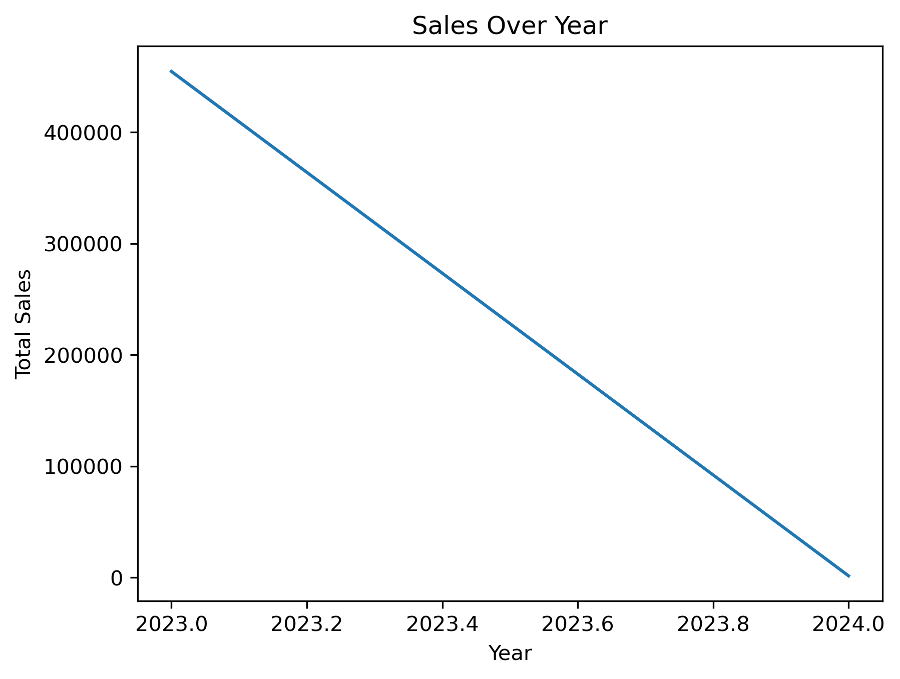
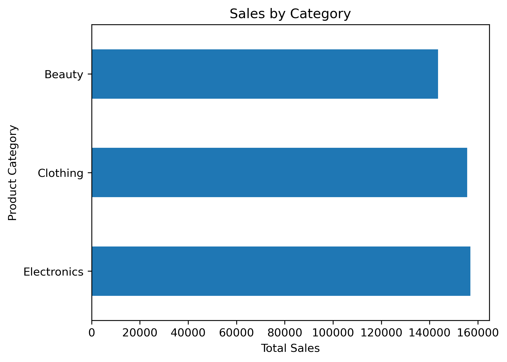
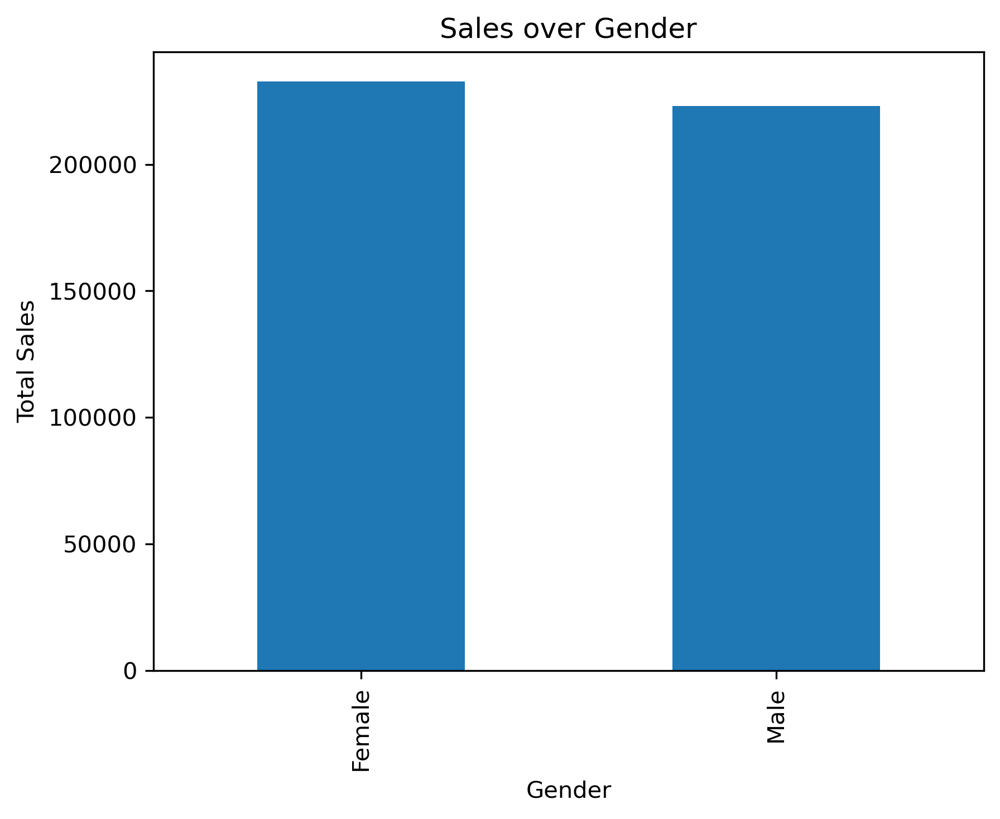
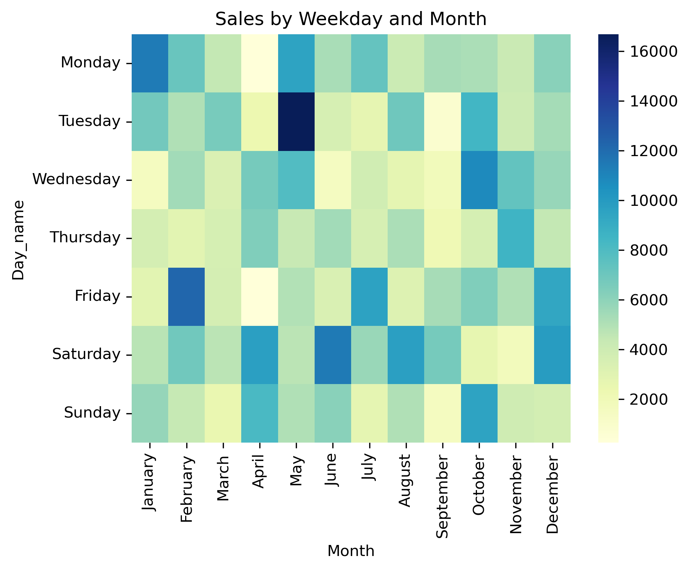

# Retail Sales Analysis Using Python

## Project Overview

This project analyzes retail sales data using Python to identify sales trends, understand customer purchasing behavior, and compare product category performance.

The analysis focuses on sales performance across time periods, customer demographics, product categories, and purchasing quantities.

## Dataset

The dataset used in this project is `retail_sales_dataset.csv`.

It contains information about retail transactions, including:

- Transaction ID
- Date
- Customer ID
- Gender
- Age
- Product Category
- Quantity
- Total Amount

## Tools and Libraries

- **Python** – Data analysis
- **Pandas** – Data cleaning, manipulation, and aggregation
- **Matplotlib** – Data visualization
- **Seaborn** – Statistical data visualization
- **Jupyter Notebook** – Interactive analysis

## Data Preparation and Cleaning

The following steps were performed to prepare the dataset for analysis:

1. Loaded the dataset using Pandas.
2. Inspected the dataset structure and column data types using `df.info()`.
3. Generated descriptive statistics using `df.describe()`.
4. Checked for duplicate records using `df.duplicated()`.
5. Checked for missing values using `df.isna().sum()`.
6. Converted the `Date` column to datetime format.
7. Extracted the year, month name, and weekday from the transaction date.
8. Created age groups to compare sales across different age ranges.

## Key Performance Indicators (KPIs)

The following metrics were calculated:

- Number of unique transactions
- Number of unique customers
- Number of product categories
- Total sales revenue
- Average transaction amount
- Total quantity sold

## Analysis and Visualizations

### 1. Sales Over Time

Analyzed sales revenue by year and month to understand sales trends and identify periods with higher revenue.

Visualizations:
- Yearly sales trend
- Monthly sales comparison

### 2. Sales by Day of the Week

Compared sales revenue across weekdays to identify which days generate the highest sales.

### 3. Sales by Product Category

Compared total sales revenue across product categories to identify the categories contributing most to overall sales.

### 4. Sales by Gender

Analyzed sales performance by gender to compare purchasing activity and sales revenue.

### 5. Sales by Age Group

Grouped customers into the following age ranges:

- 0–17
- 18–24
- 25–34
- 35–44
- 45–59
- 60+

Compared sales revenue across these age groups to identify which groups contribute most to sales.

### 6. Quantity Sold Over Time

Analyzed the total quantity sold by year and month to understand changes in product demand.

### 7. Average Transaction Amount by Product Category

Compared the average transaction amount across product categories to understand differences in spending per transaction.

## Key Findings

### Average Transaction Amount by Product Category

Based on the calculated averages:

- **Electronics:** 34.41
- **Clothing:** 34.12
- **Beauty:** 31.47

Electronics has the highest average transaction amount, followed closely by Clothing. Beauty has the lowest average transaction amount among the three categories.

The differences are relatively small. Additional analysis of total revenue and transaction counts is needed to determine which category performs best overall.

### Other Findings

Complete these findings after reviewing your analysis results:

- **Highest sales year:** 2023
- **Highest sales month:** May/2023
- **Best-performing weekday:** Saturday
- **Top-performing product category by revenue:** Electronics    
- **Age group with the highest sales:** 45-59
- **Gender with the highest sales revenue:** Female
- **Total quantity sold:** 2514
- **Top customers by spending:** CUST487 , CUST476 , CUST773

## Visualizations

### Sales Over Year



### Sales by Product Category



### Sales by Gender



### Sales by Age Group


### Sales by Weekday and Month



## Business Recommendations

Based on the completed analysis, the following recommendations can be evaluated:

1. **Product category strategy:** Compare total revenue and transaction counts before deciding which categories deserve more marketing investment.
2. **Customer segmentation:** Use age-group and gender analysis to better understand customer purchasing patterns.
3. **Sales timing:** Identify high-performing months and weekdays to help plan promotions and inventory.
4. **Product demand:** Use quantity trends to support inventory planning.
5. **Customer retention:** Identify high-value customers and consider loyalty programs to encourage repeat purchases.


## Conclusion

This project demonstrates how Python can be used to explore retail sales data, calculate key performance indicators, compare customer segments, and visualize sales trends.

The analysis provides a foundation for data-driven decisions related to marketing, product categories, customer behavior, and inventory planning.

## Project Structure

```text
retail-sales-analysis/
│
├── files/
│   └── retail_sales_dataset.csv
│
├── retail_sales_analysis.ipynb
│
└── README.md
```


## Future Improvements

- Perform more detailed customer segmentation.
- Analyze monthly and weekday sales patterns using heatmaps.
- Investigate the relationship between quantity and transaction amount.
- Compare total revenue with average transaction amount by category.
- Build an interactive dashboard using Excel or Power BI.
